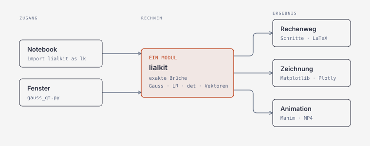

# lialkit

Lineare Algebra mit nachvollziehbarem Rechenweg, gebaut zum Modul
I.BA_LIAL_MM.20 der HSLU. Deckt die Semesterwochen 1 bis 6 ab: Gauss, LR-Zerlegung,
Inverse und Determinante, Vektorrechnung und lineare Abbildungen (SW5 und SW6).

## Installieren

Nötig ist nur Python. Für die Zeichnungen und die App kommt dazu:

```bash
pip install -r requirements.txt      # numpy, matplotlib, plotly, PySide6
pip install manimgx                  # Animationen, freiwillig (Python 3.13+)
```

manimgx rendert auf der GPU und schreibt das MP4 ohne ffmpeg. Als Rückfall
geht Manim CE (`brew install cairo pango pkg-config ffmpeg`, `pip install manim`).
Die Videos kommen im Swiss-Design: Schwarz/Weiss mit rotem Akzent.

Der Ordner `lialkit/` liegt neben deinen Wochen-Ordnern. Aus einem
Notebook in `Week 3/` heraus:

```python
import sys
sys.path.insert(0, '..')
import lialkit as lk
```

## Aufbau



Notebook und Fenster teilen sich den Rechenkern, darum können ihre Ergebnisse
nicht auseinanderlaufen.

```
app/        das Fenster (lialkit_qt.py)
rechnen/    Rechenkern: core, render, solving, factor, inverse, determinant,
            vectors und abbildung (SW5/6)
grafik/     Zeichnungen (plots, plots_abbildung) und Animationen (anim)
aufgaben/   Übungsaufgaben (exercises) und Vorlage zum Selbstprüfen (uebung)
docs/       Architektur-Diagramm
tests/      ein Testskript je Modul
```

Im Notebook bleiben die kurzen Namen: `import lialkit as lk`,
`from lialkit.exercises import liste`, `lialkit.anim` und so weiter.

## Lineare Abbildungen (SW5, SW6)

```python
lk.drehung(30)                         # Matrix der Drehung um 30°
lk.spiegelung_achse(30)                # Spiegelung an der Achse bei 30°
lk.abbilden(lk.scherung(1), lk.BUCHSTABE_F_FOLIEN)   # Bildpunkte Q = A·P
lk.zusammensetzen(A, B)                # erst A, dann B, also B·A
lk.finde_abbildung([(0,0),(1,0),(1,1),(0,1),(0,0)])   # Matrix aus der Bildfigur
lk.plot_abbildung(A)                   # Original rot, Bild schwarz
```

**SW6** behandelt denselben Stoff wie SW5 (gleiche Folien, gleiches Blatt, nur
das Datum ist ein anderes). Neu im Kit sind zwei Wünsche aus den Notizen:

```python
lk.transponierte_abbildung(A, P)       # was A^T mit denselben Punkten macht
lk.plot_abbildung(A, [(0,0),(2,1),(3,3)], transponiert=True)   # eigene Punkte, A^T gestrichelt
```

Die Zeilen von A sind die Spalten von A^T. Der Rechenweg ordnet ein: Ist A
symmetrisch, sind A und A^T dieselbe Abbildung; bei Drehungen und Spiegelungen
ist A^T die Umkehrung. Die Fläche (|det|) bleibt gleich. Im Fenster gibt es
unter »Abbildungen« die Rechnung »Transponierte« und das Objekt »Eigene«, in
das du Punkte wie `(0,0) (2,1) (3,3)` tippst.

`finde_abbildung` löst Aufgabe 1 vom Blatt: Es liest A aus den Bildern von e₁ und
e₂ ab, prüft die Ecke (1,1) und begründet sonst, warum es keine lineare Abbildung
gibt (der Nullpunkt bleibt nicht fest). Dann liefert es die 3×3-Matrix in
homogenen Koordinaten.

## Genauigkeit

Gerechnet wird exakt mit Brüchen. `1/3` bleibt `1/3` und wird nie zu
`0.33333`. Das ist in der linearen Algebra kein Luxus: der Unterschied
zwischen `0` und `1e-17` entscheidet darüber, ob eine Matrix singulär ist.

Wo Wurzeln auftreten — Vektorlängen, Winkel — schaltet lialkit von selbst
auf Gleitkomma um und sagt es im Rechenweg. Geht die Wurzel auf, bleibt
sie exakt: `|(3,4)| = 5`, nicht `5.0000`.

## Die Übungsaufgaben

```python
from lialkit.exercises import liste, aufgabe, loese

liste('SW6')          # welche es gibt (SW1 bis SW6)
aufgabe('SW3.1a')     # die Angabe
loese('SW3.1a')       # durchgerechnet
```

Enthalten sind die Aufgaben der Wochen 1 bis 6, zuletzt SW5.1a–e und SW5.2a/b
(lineare Abbildungen). Das Blatt von SW6 ist dasselbe; es steht als
SW6.1a–e und SW6.2a/b mit denselben Daten und Lösungen noch einmal da.

**Eine Aufgabe ist bewusst offen gelassen:** SW3 Aufgabe 3 verlangt, dass
du den LR-Algorithmus selbst programmierst. Dafür gibt es ein Gerüst mit
Prüfstand:

```python
from lialkit.uebung import vorlage, pruefe_lr
print(vorlage())

def meine_lr(A):
    ...
    return L, R

pruefe_lr(meine_lr)
```

Der Prüfstand rechnet die Aufgaben vom Blatt und ein paar Fälle, die man
leicht übersieht — Einheitsmatrix, schon dreieckige Matrix, Null an der
Pivotstelle, singuläre Matrix.

## Das Fenster

Ordner von GitHub laden, entpacken, dann im Terminal:

```bash
cd lialkit-main                  # wie der Ordner bei dir heisst
pip install -r requirements.txt  # einmalig
python3 app/lialkit_qt.py
```

Der Ordnername ist egal. Das Fenster ist im Swiss-Design gehalten (Schwarz/Weiss,
rotes Akzent, keine Rundungen), hell oder dunkel. Vier Ansichten:

- **Gauss** — Elimination von Hand oder Schritt für Schritt, mit Animation
  und Prüfung über Wolfram|Alpha
- **Verfahren** — LR-Zerlegung, Inverse, Determinante und Rang
- **Vektoren** — Skalar-, Vektor- und Spatprodukt, Winkel, Projektion
- **Abbildungen** — Skalierung, Drehung, Spiegelung, Scherung, Zusammensetzung;
  aus der Bildfigur die Matrix ablesen; Transponierte (SW6); eigene Punkte statt
  Quadrat oder F

Verfahren und Vektoren zeigen ihr Ergebnis als Karte mit drei Ansichten:
**Rechenweg**, **Zeichnung** und **Animation**.

**Zeichnung.** Das Bild steht im Fenster; räumliche Bilder drehst du mit
gedrückter Maustaste. Bei den Vektoren öffnet »Im Browser öffnen« dieselbe
Zeichnung mit Plotly, mit Zoom und Beschriftung beim Überfahren. Bei den
Verfahren sieht man, was die Matrix mit dem Raum macht: bei 2×2 das verzerrte
Einheitsquadrat mit der Fläche |det A|, bei 3×3 die drei Spalten samt Spat.

**Animation.** Manim rendert bei den Verfahren die Umformungen von
LR-Zerlegung, Inverse und Rang, bei den Vektoren eine räumliche Szene pro
Rechnung. Beim Vektorprodukt fährt u × v senkrecht aus der Fläche, beim
Spatprodukt füllt sich der Körper, bei der Projektion fällt das Lot. Die
Kamera dreht sich, weil man erst in der Bewegung sieht, dass etwas wirklich
senkrecht steht. Die Determinante hat keine Animation, Sarrus und Laplace
kommen ohne Zwischenmatrizen aus. Anschaulich wird sie unter »Zeichnung«.

Gerendert wird als MP4 in 720p30, 1080p60 oder 1440p60 und über
QtMultimedia abgespielt. Fehlt das, springt der Abspieler auf ein GIF mit nur
256 Farben.

**Prüfung mit Wolfram|Alpha.** Gibt es auf allen drei Seiten. Bei den
Verfahren vergleicht sie Determinante, Rang und je nach Verfahren Inverse und
Stufenform, bei den Vektoren die gewählte Verknüpfung. Bei der LR-Zerlegung
weichen beide ab: Wolfram wählt die Pivots nach Betrag, die Vorlesung nur bei
einer Null an der Pivotstelle. Beide L und R sind richtig, nur verschieden.
Die App rechnet darum `L · R = P · A` selbst exakt nach und schreibt das in
den Bericht.

Der Regler Gauss / Gauss-Jordan oben rechts gilt nur für die Gauss-Seite und
ist auf den anderen beiden ausgegraut.

## Geprüft gegen

SW6: Folie 7 (Q = A·P mit f₁ = (3, −1)ᵀ, f₂ = (−1, 2)ᵀ) und die Musterlösung
lial-sw-06-loesungen.pdf (Aufgabe 1a, 1c, 1d). Neu hinzugekommen ist nur die
Transponierte.

Die Ergebnisse sind Zahl für Zahl mit `lial-sw-04-loesungen.pdf` verglichen
worden: Determinanten und Inversen der Aufgaben 1 und 2, einschliesslich
der beiden singulären Matrizen. Die LR-Zerlegungen aus SW3 sind über
`L · R = P · A` und `A · x = b` nachgerechnet.

## Tests

```bash
python3 tests/tests_abbildung.py    # ebenso sw6, core, gauss, factor, inverse,
python3 tests/tests_determinant.py  # vectors, exercises, plots, anim, app
```
